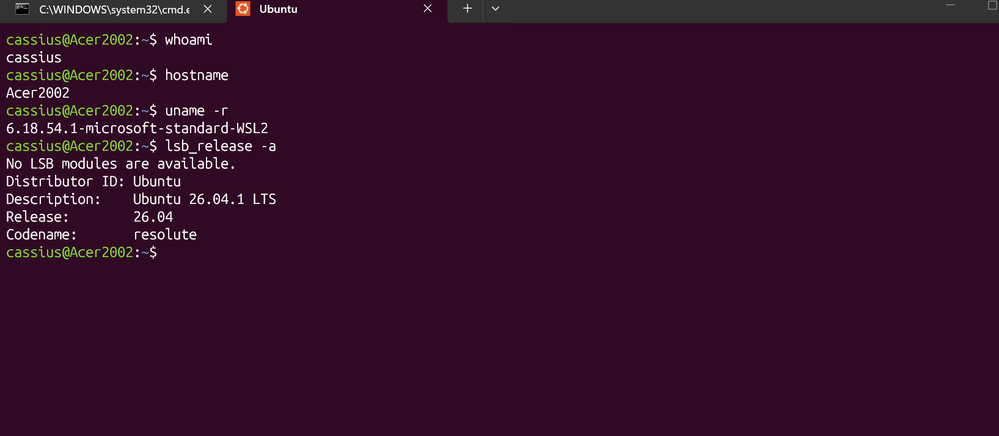

Overview
A hands-on Linux administration project simulating a small business IT environment using Ubuntu Linux on Windows 11 through WSL2.
The project focuses on user account management, group administration, directory organization, file permissions, and basic system troubleshooting.

Technologies
- Windows 11
- Ubuntu Linux
- WSL2
- Bash / Linux Command Line

Skills Practiced
- Linux user and group management
- Creating and organizing directories
- File ownership and permissions (chmod, chown)

System information and resource monitoring
- Basic network configuration
- Troubleshooting access and permission issues

Project Screenshots

System Information

Company Directory Structure
!Company Directories

User Account Management
!User Accounts

Group Management
!Group Management

File Permissions
!File Permissions

Learning Outcomes
Developed hands-on experience with Linux administration, account provisioning, access control, and basic IT troubleshooting through a simulated business environment.

Project Status
In Progress
Career Focus: Entry-Level IT Support | Help Desk | Desktop Support
