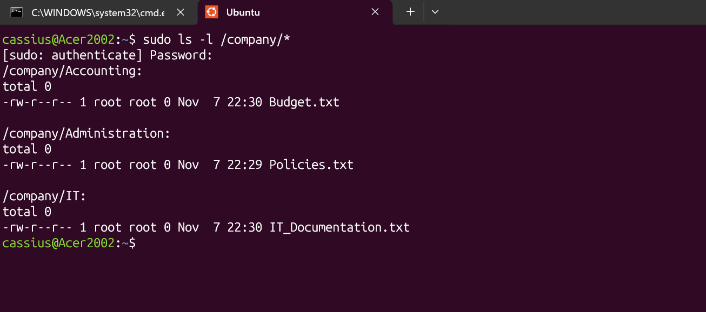
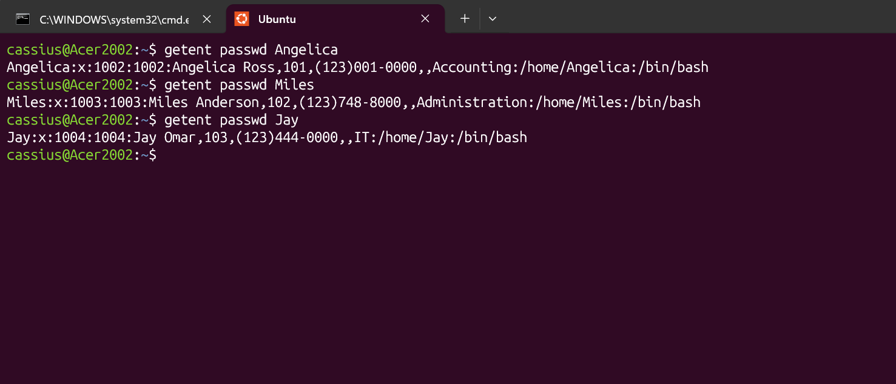
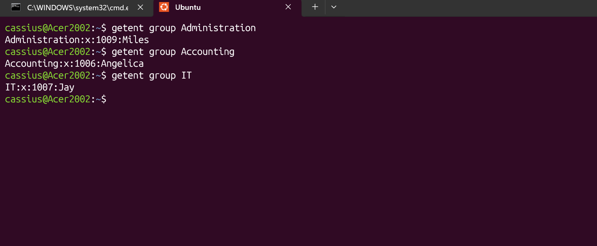
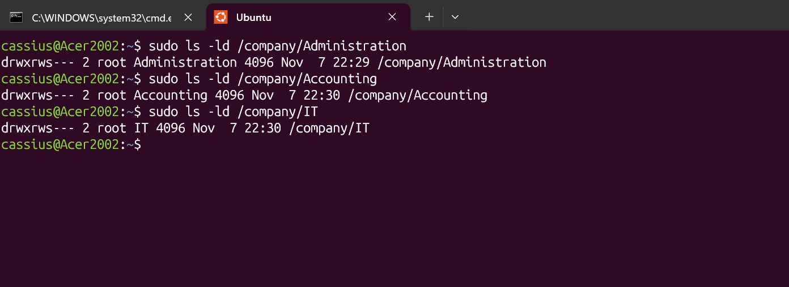
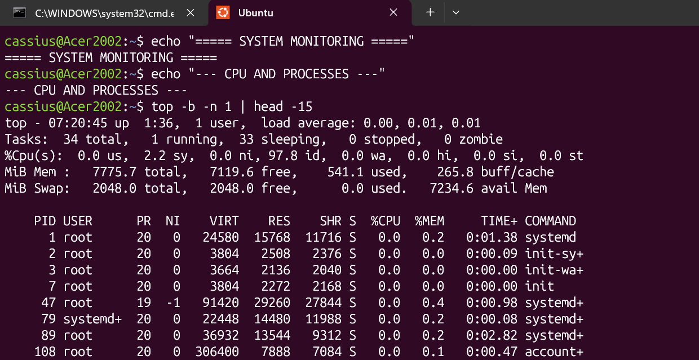
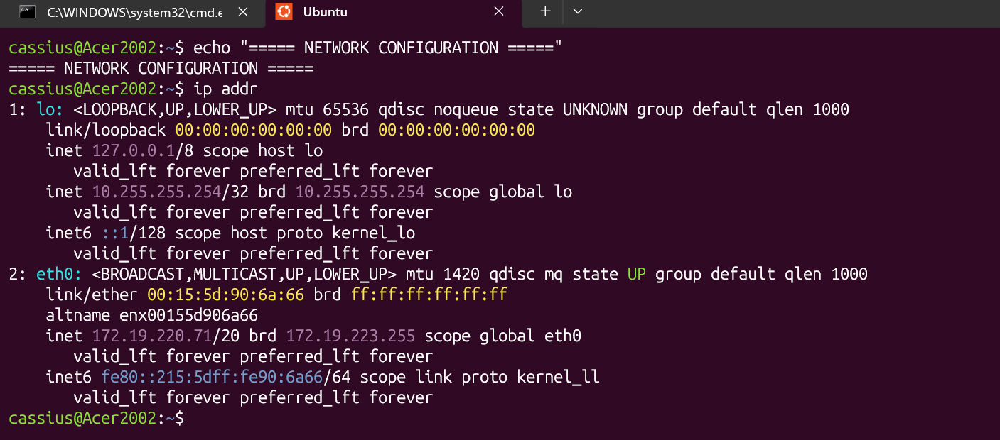

OVERVIEW
A hands-on Linux administration project simulating a small business IT environment using Ubuntu Linux on Windows 11 through WSL2.
The project focuses on user account management, group administration, directory organization, file permissions, and basic system troubleshooting.

TECHNOLOGIES
- Windows 11
- Ubuntu Linux
- WSL2
- Bash / Linux Command Line

SKILLS PRACTICED
- Linux user and group management
- Creating and organizing directories
- File ownership and permissions (chmod, chown)

System information and resource monitoring
- Basic network configuration
- Troubleshooting access and permission issues

PROJECT SCREENSHOTS

1. System Information

Identified the Ubuntu environment and inspected system details, including the current user, hostname, Linux kernel version, operating system, disk space, and memory usage.

Commands used:

- whoami
- hostname
- uname -r
- lsb_release -a
- df -h
- free -h

2. Company Directory Structure

Created and organized a simulated company directory structure representing three departments: Administration, Accounting, and IT Support.

Commands used:

- mkdir
- ls -l
- find

3. User Account Management

Created simulated employee accounts to practice Linux user provisioning and account administration.

Commands used:

- adduser
- userdel
- getent passwd
- whoami

4. Group Management 

Created departmental Linux groups and assigned employee accounts to their corresponding groups to practice access management.

Commands used:

- groupadd
- groupdel
- usermod -aG
- groups
- getent group

5. Directory Permissions

Configured directory ownership and permissions to simulate departmental access restrictions and practice the Linux principle of least privilege.

Commands used:

- chown
- chmod
- ls -ld
- sudo

6. System Monitoring 

Inspected system resources and running processes to practice basic Linux system monitoring and resource management.

Commands used:

- top
- free -h
- df -h

 
.png)
.png)

7. Network Configuration 

Inspected network interfaces, routing information, and DNS configuration within the Ubuntu WSL2 environment.

Commands used:

- ip addr
- ip route
- cat /etc/resolv.conf

 
.png)

Learning Outcomes

Developed hands-on experience with Linux administration, account provisioning, access control, and basic IT troubleshooting through a simulated business environment.

Project Status

In Progress
Career Focus: Entry-Level IT Support | Help Desk | Desktop Support
